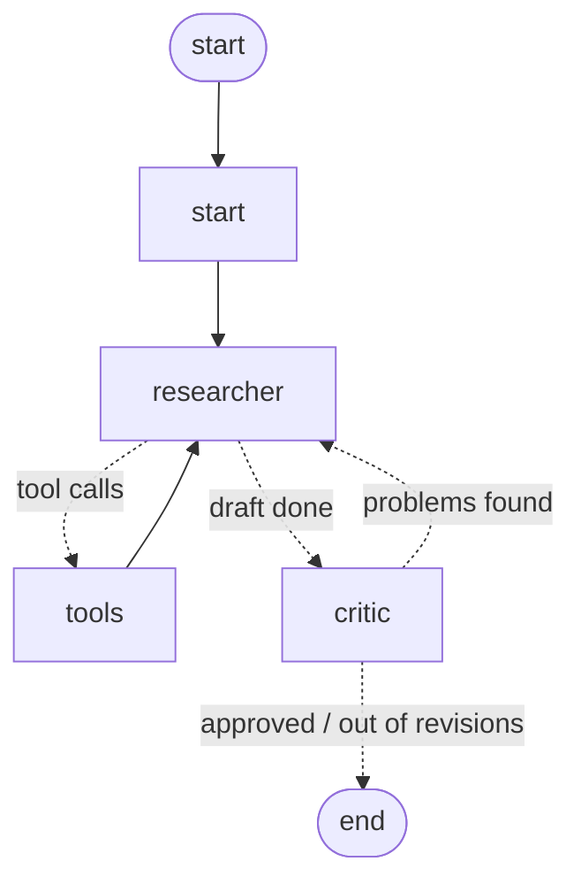

# research-assistant-langchain

A LangGraph agent that searches the web, reads pages and writes a short report with citations.
A critic node checks that every claim has a source and sends the draft back if not. After at most `MAX_REVISIONS` send-backs (default 2), the graph ends and prints a warning if the critic still had objections. The researcher has a budget of `MAX_TOOL_ROUNDS` tool-calling steps per question (default 12); when it runs out, it must write the report from the sources it already has.



The critic combines two checks:
1. **Deterministic**: every `[n]` in the text is listed under `## Sources`, and every source URL actually came back from a search or fetch in this turn, so made-up URLs are caught and results are real.
2. **LLM review**: Claude reads the draft next to the fetched page text and flags claims that are uncited or not supported by the evidence (structured output: `approved` and `problems`).

Web search uses DuckDuckGo through `ddgs`, so it needs no extra API key.

## Usage

```bash
# one question
python -m research_assistant --thread demo "How do LangGraph checkpointers work?"

# follow-up on the same thread: the agent remembers the previous report
python -m research_assistant --thread demo "How does that compare to CrewAI's memory?"

# interactive chat on a thread
python -m research_assistant --thread demo

# print the compiled graph as Mermaid
python -m research_assistant --graph
```

Thread memory is stored in `checkpoints.db`. A new `--thread` id starts a fresh conversation.
